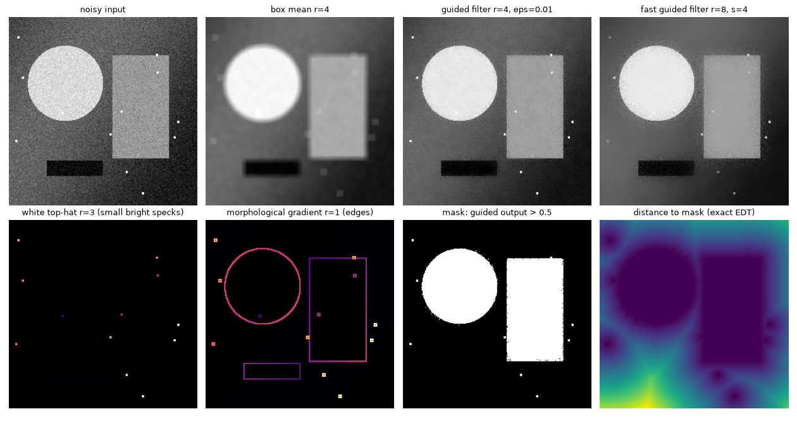

# fast-image-ops

[](https://github.com/ngo-binh0108/fast-image-ops/actions/workflows/tests.yml)

Image filters in pure NumPy whose cost per pixel **does not grow with the window size**.
A 65 x 65 window costs the same as a 5 x 5 one. Every algorithm is fully vectorized,
has no compiled extensions, and is checked against an independent reference in the tests.



| Operation | Algorithm | Cost per pixel | Naive cost |
|---|---|---|---|
| `box_mean`, `box_sum` | separable running sums (summed-area table) | O(1) | O(r^2) |
| `guided_filter` | He, Sun, Tang, *Guided Image Filtering*, TPAMI 2013 | O(1) | O(r^2) |
| `fast_guided_filter` | He & Sun, *Fast Guided Filter*, arXiv:1505.00996 | O(1 / s^2) box work | O(r^2) |
| `dilate`, `erode`, `opening`, `closing`, `gradient`, `white_tophat`, `black_tophat` | van Herk / Gil-Werman | O(1), about 3 comparisons per axis | O(r^2) |
| `distance_transform` | Felzenszwalb & Huttenlocher, exact Euclidean | O(1) amortized | O(number of zero pixels) |

## Install

```bash
pip install git+https://github.com/ngo-binh0108/fast-image-ops
# or, from a clone, with test dependencies:
pip install -e ".[test]"
```

The only runtime dependency is NumPy. SciPy is used only by the tests and the benchmark.

## Usage

```python
import numpy as np
import fast_image_ops as fio

img = np.random.rand(512, 512)          # grayscale, or (H, W, C) with channels last
rgb = np.random.rand(512, 512, 3)

fio.box_mean(img, radius=8)                      # 17 x 17 mean, borders clipped (no padding bias)
fio.guided_filter(img, img, radius=8, eps=1e-2)  # edge-preserving smoothing
fio.guided_filter(rgb, img, radius=8, eps=1e-3)  # color guide, e.g. matting / depth refinement
fio.fast_guided_filter(rgb, img, 8, 1e-3, scale=4)

fio.dilate(img, (2, 6))                  # 5 x 13 rectangle; radius can be (ry, rx)
fio.white_tophat(img, 3)                 # bright details smaller than 7 x 7

mask = img > 0.99
d = fio.distance_transform(~mask)        # distance from each pixel to the nearest True pixel of mask
```

## How the algorithms work

**Box mean.** One cumulative sum per axis turns every window sum into a
difference of two entries. Windows are clipped at the border and divided by the
number of pixels actually inside, which keeps the guided filter's statistics
unbiased at the edges.

**Guided filter.** In every window the output is modelled as a linear function
of the guide, `q = a . I + b`, fitted to the input by ridge regression
(`a = (Sigma_I + eps U)^-1 cov(I, p)`, `b = mean(p) - a . mean(I)`). Every term
is a box mean, so the cost does not depend on the radius. For a color guide:

- **Batched box filter:** all 13 per-pixel products (I, p, the upper triangle of
  I I^T, and I p) go through one box-filter call.
- **Closed-form 3 x 3 solve:** the system is solved with a cofactor inverse on
  whole-image component arrays. That is faster than a batched
  `np.linalg.solve`.

The fast variant fits `a` and `b` on an image `s` times smaller, upsamples
them bilinearly, and applies them to the full-resolution guide, so edges stay
sharp.

**van Herk / Gil-Werman morphology.** Pad the line and split it into blocks
whose length is the window size `k`. Any window of length `k` covers the end of
one block and the start of the next. Its maximum is therefore
`max(suffix_max[start], prefix_max[end])`, and both running extrema are a single
`np.maximum.accumulate` over the block axis. Pixels outside the image are
ignored, which matches `scipy.ndimage`'s `mode='nearest'`.

**Exact Euclidean distance transform.** The squared transform separates into
1-D problems `d(q) = min_p (q - p)^2 + f(p)`, solved first along rows and then
along columns. Each 1-D problem is the lower envelope of parabolas, built with
a stack in one left-to-right pass. That pass is sequential along a line. So the
loop runs over positions, and each step is vectorized across all lines at once,
using per-line stack pointers and masked pops. An n x n image therefore takes
O(n) Python iterations, not O(n^2). The squared results are integers and match
SciPy exactly.

## Benchmarks

`python benchmarks/bench.py 512`: a 512 x 512 float64 image, the best of 3
runs, on an AMD Zen 3 CPU (one thread). Times are in milliseconds. The naive
window scan is only run up to r=8.

| filter | implementation | r=2 | r=8 | r=32 |
|---|---|---|---|---|
| box mean | fast_image_ops | 11.9 | 12.1 | 12.5 |
| box mean | scipy uniform_filter | 4.0 | 3.7 | 3.9 |
| box mean | naive window scan | 13.5 | 59.4 | - |
| dilation | fast_image_ops | 14.1 | 11.9 | 13.1 |
| dilation | scipy grey_dilation | 6.7 | 6.7 | 6.1 |
| dilation | naive window scan | 32.4 | 107.9 | - |
| guided, gray guide | guided_filter | 81.2 | 83.3 | 80.0 |
| guided, gray guide | fast_guided_filter s=4 | 26.0 | 24.7 | 25.0 |
| guided, color guide | guided_filter | 337.0 | 298.1 | 317.0 |
| guided, color guide | fast_guided_filter s=4 | 65.6 | 63.0 | 61.7 |

Exact EDT with 1% zero pixels: 115 ms here, 16 ms for SciPy.

What the numbers show:

- **Window size:** every fast_image_ops row stays flat as the radius grows,
  while the naive scan grows with r^2.
- **Fast guided filter:** it is 3 to 5 times faster than the full one.
- **SciPy:** SciPy's compiled C filters are still 2 to 3 times faster on a
  plain box or max filter, and about 10 times faster on the EDT. This library
  doesn't try to beat compiled code. It gives readable, dependency-light
  versions with the same asymptotic cost, plus a guided filter, which SciPy
  doesn't have.

## Tests

```bash
python -m pytest
```

The 77 tests compare every filter with an independent reference:

- **Box mean:** brute-force window loops.
- **Guided filter:** a per-window ridge-regression solve written straight from
  the paper's definition, for gray, 2-channel and color guides.
- **Morphology:** `scipy.ndimage` grey and binary morphology, for float, uint8,
  int16 and bool images.
- **Distance transform:** exact equality of squared distances with
  `scipy.ndimage.distance_transform_edt`, plus a brute-force nearest-zero
  search.

## License

MIT
